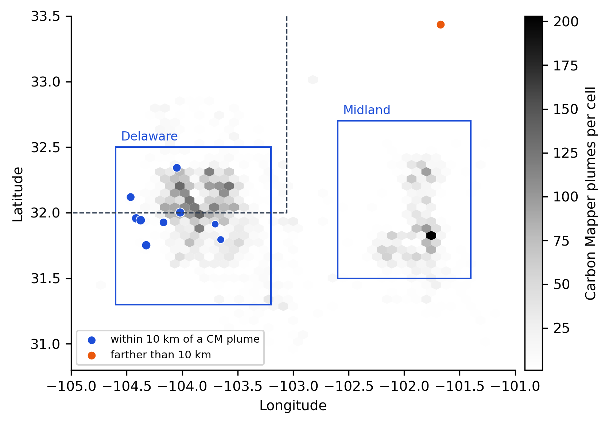
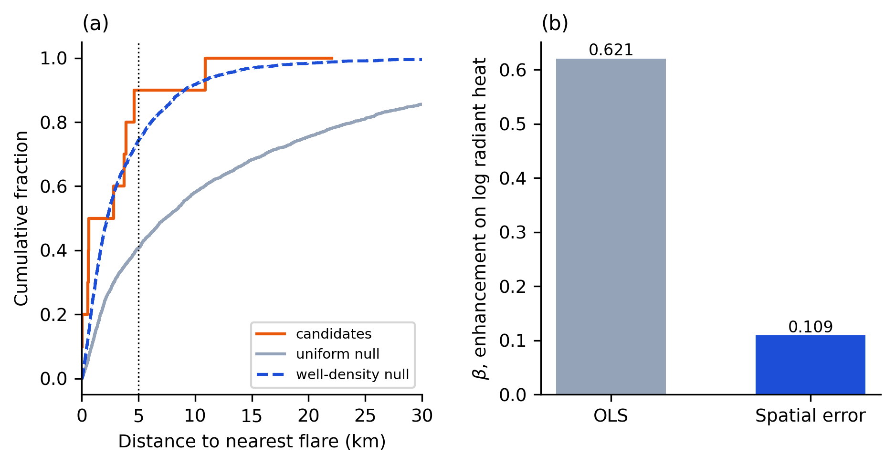
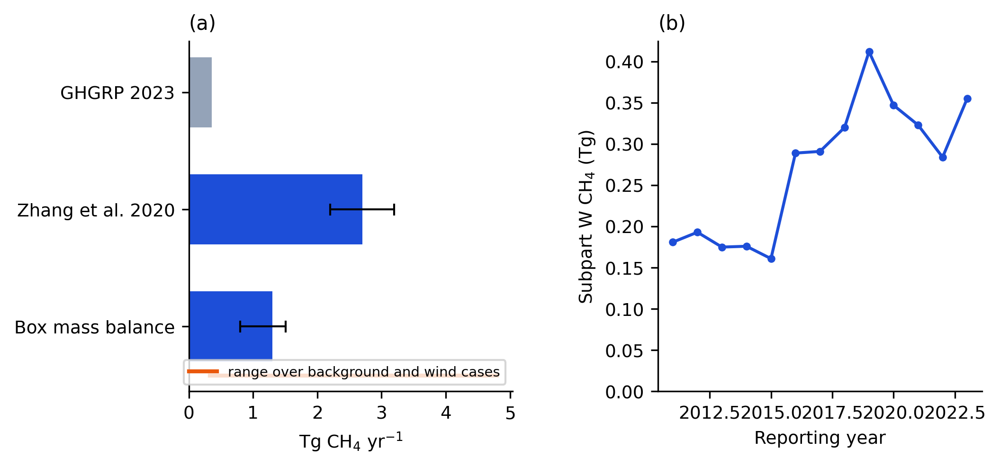

## Highlights

- Permian TROPOMI plumes look tied to flares against random comparison points.
- Drawing comparison points from well density removes the link in two summers.
- Matching reference points to QA-passing overpass pixels weakens even the uniform result.
- A grid-scale flaring effect vanishes once spatial autocorrelation is modelled.
- Sign-inverted scenes yield 15 and 16 clusters, exposing detector ambiguity.
- Four other US basins gave too few summer detections to test.

## Abstract

Proximity to a gas flare is often used to interpret a satellite methane enhancement, yet flares and
other oil-field equipment occupy much the same terrain. I tested how the choice of comparison
locations changes that interpretation for Sentinel-5P TROPOMI candidates in the Permian Basin. The
June to August searches yielded 30 candidates from 121 overpasses in 2024 and 10 from 119 in 2026.
Within 5 km of a persistent flare, candidates were enriched by factors of 1.64 and 1.97 relative to
locations sampled uniformly across the study box. Relative to locations sampled from the density of
52,546 mapped wells, the factors were 0.90 and 1.08; both day-bootstrap intervals included one.
The same change of interpretation occurred for proximity to Carbon Mapper sources and for well-density
kernel bandwidths of 4, 8 and 16 km. Restricting both controls to QA-passing pixels on each
candidate's overpass reduced the uniform factors to 1.42 and 1.69; their day-bootstrap intervals
then also included one. A spatial-error model reduced the grid-scale flaring
coefficient by 94% in 2024 and 82% in 2026. The detector also found 15 and 16 clusters after the
XCH₄ fields were sign-inverted, compared with 30 and 10 in the original fields. These counts flag
ambiguity in the candidate lists; they are not estimates of each candidate's probability of being
false. Four other basins yielded at most six candidates apiece in the 2026 window. The practical
result is that proximity alone does not distinguish flares from the surrounding oil-field
infrastructure at TROPOMI resolution. A published inversion for 2018 to 2019 estimated Permian emissions
at 2.7 ± 0.5 Tg yr⁻¹, whereas the 2023 Subpart W total assembled here is 0.355 Tg. Their 7.6-fold
ratio compares different years and reporting scopes and is context for the attribution problem, not
a contemporaneous validation of it.

**Keywords:** methane; TROPOMI; source attribution; null model; spatial autocorrelation; gas flaring;
Permian Basin

## 1 Introduction

The Permian Basin in west Texas and southeastern New Mexico is a major oil-producing region. An inversion of TROPOMI
observations for May 2018 to March 2019 placed emissions at 2.7 ± 0.5 Tg yr⁻¹, a loss equal to
3.7 % of gas production and more than twice the bottom-up inventory (Zhang et al., 2020). The
discrepancy motivates a more basic question: which sources can a coarse satellite enhancement
actually identify? The inversion and the Subpart W reports cover different periods and scopes, so
their ratio is descriptive rather than a direct estimate of missing emissions in a common year.

Satellites now resolve the largest of those sources one plume at a time. TROPOMI maps
column-averaged methane (XCH₄) daily at about 5.5 by 7 km (Lorente et al., 2021), and automated
searches return dozens of large plumes in major oil and gas basins (Lauvaux et al., 2022; Schuit et
al., 2023). A single detection covers 40 to 125 km², which in the Permian can hold hundreds of wells,
so studies assign source types by spatial association. If detections fall near flares more often
than chance allows, flaring is implicated. The mechanism is plausible: flares in three US basins
destroyed 91 % of the methane routed to them on average, against the 98 % assumed in inventories
(Plant et al., 2022).

Reference points spread evenly over a study box answer a particular question: whether detections
occur closer to flares than arbitrary locations in that box. They do not answer whether detections
are closer to flares than other oil-field locations. The latter comparison is needed before flare
proximity can discriminate among industrial source types. Single-overpass candidates also require a
check on detector symmetry near the retrieval noise floor.

I asked whether the apparent link between TROPOMI detections and flaring in the Permian survives a
reference set drawn from the oil field itself, a sign-inverted negative control and a spatial-error model,
and whether the answer holds across two summers. It does not hold in either summer. Against well
density the flare association disappears, and the grid-scale correlation goes with it once
autocorrelation is modelled.

## 2 Data and methods

### 2.1 Observations

The study box spans 105.0° W to 101.0° W and 30.8° N to 33.5° N and contains the Delaware and Midland
sub-basins. I used every offline TROPOMI L2 CH₄ granule whose sensing began between 1 June and
31 August in 2024 (121 granules, processor 02.06) and in 2026 (119 granules, processor 02.09), keeping
bias-corrected XCH₄ where `qa_value` ≥ 0.5. Each granule covers a full orbit, so the 2026 granules
were also searched over the Bakken, Denver-Julesburg, Eagle Ford and Anadarko basins (box
coordinates in the code repository).

### 2.2 Detection and false positives

QA-passing pixels were averaged onto a 0.05° grid. A 0.6° median filter supplied the regional
background, and the residual noise scale σ was set to 1.4826 times its median absolute deviation, a
measure a few large plumes cannot inflate. A cell was flagged when its residual exceeded both 3σ and
the median retrieval precision of the scene, and groups of at least three connected flagged cells
became candidates. Each candidate took the median time of the scanlines crossing the box, because a
granule can begin more than an hour before the satellite reaches the basin.

As a negative control I ran the identical detector on each scene with the sign of XCH₄ reversed.
The median filter commutes with negation, so the operation tests negative residual excursions under
the same filtering and threshold. The resulting count diagnoses asymmetry and background or retrieval
structure. It cannot, by itself, give a false-discovery rate for positive candidates: positive
plumes, negative retrieval artifacts and scene-dependent backgrounds need not have symmetric tails.

### 2.3 Emission rates and detection floor

Rates follow the integrated mass enhancement method, Q = U · IME / L with L = √A (Varon et al.,
2018). Column enhancement was converted to mass with the scene surface pressure,

$$\Delta\Omega = 10^{-9}\,\Delta X\,\frac{p_s}{g\,M_{\mathrm{air}}}\,M_{\mathrm{CH_4}},$$

which over the basin (about 90 kPa) is 10 % smaller than at sea level. U is the ERA5 10 m wind at
the candidate, interpolated to the overpass time. The 1σ relative uncertainty adds the wind term
with its effective-wind calibration (50 %), retrieval (15 %) and length scale (25 %) in quadrature,
58 % in all. A three-cell cluster at a scene's threshold T gives that scene's detection floor,
Q_min = U ΔΩ(T) √(3 A_cell).

### 2.4 Proximity tests

For each candidate I computed the great-circle distance to the nearest persistent flare, defined as
a site in the upper half of 2019 to 2021 radiant heat in the Flaring Monitor record built on VIIRS
Nightfire (Elvidge et al., 2016), and to the nearest Carbon Mapper plume observed through August
2026. The same distances were computed for two reference sets. The even set was drawn uniformly in
the box. The well-density set was drawn from a Gaussian kernel density (bandwidth 8 km) of all
52,546 OpenStreetMap nodes in the box tagged as oil or petroleum wells, so a reference point lands in
a dense part of the field as often as the field is dense. Enrichment is the share of candidates
within a tolerance (5 km for flares, 10 km for plumes) divided by the share of reference points.
Candidates from one overpass share wind, retrieval conditions and sometimes a plume, so 95 %
intervals for enrichment come from a bootstrap that resamples whole days. I repeated the well-density
test at bandwidths of 4 and 16 km and applied every test to the inverted-scene clusters.
The reported Mann-Whitney p values treat candidate distances as independent; they are exploratory
and should be read alongside the day-bootstrap intervals. As an observation-opportunity sensitivity
test, I restricted each candidate's comparison locations to QA-passing TROPOMI pixel centres in its
own granule. The uniform control gives every passing pixel equal weight. The well-density control
weights those same pixels by the original 8 km kernel surface. For each candidate I calculated the
fraction of eligible pixels within 5 km of a persistent flare under each weighting, then divided
the observed candidate fraction by the mean candidate-specific reference fraction. The bootstrap
resamples candidate days and carries their reference fractions with them. This test controls for
where the satellite returned a valid retrieval on each candidate overpass; it does not fully model
spatial variation in detection sensitivity within the QA-passing area.

### 2.5 Grid-scale association

On the 0.05° grid I correlated the logarithm of radiant heat from flares active in at least six
months with mean methane enhancement, using cells observed at least ten times. Five hundred toroidal
shifts of the flaring field supplied a null that keeps that field's spatial structure. Both fields
vary smoothly over tens of kilometres, so I also computed Moran's I with row-standardised
eight-nearest-neighbour weights (Moran, 1950) and refitted the regression by maximum likelihood with
a spatial-error term (Anselin, 1988) in PySAL (Rey and Anselin, 2007).

### 2.6 Reported emissions and a box mass balance

Subpart W methane reports for Texas and New Mexico came from the 2023 EPA Envirofacts extract used in
this analysis. Production and gathering facilities report by geological basin, so reports naming
basin 430 or "Permian" were kept wherever their coordinates fell, reports naming another basin were
dropped, and other facilities were kept if their coordinates lay inside the box.

As a check on the published total, I estimated basin emissions for each overpass as
Q = U · W · ΔΩ(X_basin − X_bg), where X_basin is the median XCH₄ inside the box, X_bg the median over
a 1° ring around it, W the box width across the wind and U the mean ERA5 100 m wind. XCH₄ is lower
over high ground because more of the column there is stratospheric air, so a linear dependence on
surface pressure and latitude, fitted on the ring, was removed first. The basin value is the median
over overpasses with a bootstrap 95 % interval.

## 3 Results

### 3.1 Candidates sit at the detection floor and many may be noise

The 2024 search returned 30 candidates on 14 days, with estimated rates of 14 to 54 t h⁻¹ (median
24 t h⁻¹). The 2026 search returned 10 candidates on 5 days, at 18 to 38 t h⁻¹ (median 30 t h⁻¹).
Median detection floors were 24 and 26 t h⁻¹, so the candidates are the largest events the
instrument registers on favourable days (Fig. 1). A 25 t h⁻¹ source at a given location would have
been detectable on a median of 5.8 % of overpasses in 2024 and 4.2 % in 2026.

The inverted scenes produced 15 clusters in 2024 and 16 in 2026. These are large counts relative to
the 30 and 10 positive candidates, especially in 2026, but the positive-to-negative ratio is not a
false-discovery estimate. No candidate in either year matched the local pattern of surface albedo in
the implemented screen; that screen does not exclude every retrieval artifact. The lower 2026 yield
coincides with a change of retrieval processor, whose contribution I did not isolate. Outside the
Permian the search found 0 candidates in the Bakken and the
Denver-Julesburg Basin, 2 in the Eagle Ford and 6 in the Anadarko, against 2, 4, 36 and 9 clusters in
the inverted scenes (Table 1).

**Figure 1.** Study box with the 2026 candidates, sized by estimated rate, over the density of Carbon
Mapper plumes. Blue candidates lie within 10 km of a mapped plume.

### 3.2 The flare association depends on the reference set

Candidates sit closer to flares than evenly spread points in both summers (Table 2). In 2024, 67 % of
candidates lie within 5 km of a persistent flare against 41 % of reference points, an enrichment of
1.64 (day-bootstrap interval 1.07 to 2.12, p = 0.003). In 2026 the shares are 80 % and 41 % (1.97,
interval 1.05 to 2.46, p = 0.013).

Reference points drawn from well density are themselves close to flares: 74 % lie within 5 km.
Against them, flare enrichment falls to 0.90 in 2024 (interval 0.59 to 1.16, p = 0.90) and 1.08 in
2026 (0.58 to 1.35, p = 0.48). Carbon Mapper plumes follow the same pattern, from 1.36 and 1.75 under
the even null to 0.81 and 1.04 under the well-density null. Across bandwidths of 4, 8 and 16 km the
well-density enrichment stays between 0.78 and 1.16 for both features in both years. The candidate
distance distribution lies on the well-density curve and well apart from the even one (Fig. 2a).

Conditioning both reference sets on QA-passing pixels weakens the contrast (Table 4). The uniform
reference fraction rises from 0.407 in the box-wide test to 0.469 in 2024 and 0.473 in 2026. Its
enrichment falls to 1.42 (95% day interval 0.93 to 1.83) and 1.69 (0.95 to 2.01), respectively.
The opportunity-matched well-density fractions are 0.778 and 0.795, giving enrichment of 0.86
(0.56 to 1.10) and 1.01 (0.56 to 1.24). All four intervals include one. The original box-wide
uniform result therefore depends partly on where valid retrievals occurred, whereas neither
well-density result supports flare-specific enrichment.

The inverted-scene clusters are not significantly close to flares under the even null (p = 0.86 in
2024, 0.29 in 2026). The positive candidates sit in the industrial part of the box more than these
negative excursions do, but the test does not identify which industrial source produced them.

### 3.3 The grid-scale correlation does not survive a spatial-error model

Flaring and methane enhancement are weakly correlated on the grid in both summers (Spearman ρ = 0.188
over 986 cells in 2024 and 0.19 over 1,016 cells in 2026), and the toroidal-shift test rates these
correlations unlikely by chance (p = 0.014 and 0.01). The enhancement field is strongly
autocorrelated (Moran's I = 0.54 and 0.66, p = 0.002 in both years), and so are the residuals of an
ordinary least-squares fit. With a spatial-error term the flaring coefficient falls from 0.513 to
0.030 in 2024 (p = 0.66) and from 0.621 to 0.109 in 2026 (p = 0.11; Fig. 2b).

**Figure 2.** (a) Cumulative distribution of distance to the nearest persistent flare for the 2026
candidates and both reference sets. (b) Coefficient of log flaring radiant heat in a regression of
methane enhancement, without and with a spatial-error term (2026).

### 3.4 Reported and observed totals

Subpart W reports attributed to the basin total 0.355 Tg for 2023 from 242 reports, about double the
0.181 Tg reported for 2011. The 2023 total is 7.6 times smaller than the published 2018 to 2019
inversion; this cross-period comparison is not a matched-year inventory evaluation. The box mass balance gives
1.35 Tg yr⁻¹ for 2024 (interval 0.62 to 1.79, 55 overpasses) and 1.30 Tg yr⁻¹ for 2026 (0.80 to 1.51,
51 overpasses), three to four times the reported total. Its assumptions move it more than its
intervals suggest: for 2026, alternative backgrounds and wind levels give 0.33 to 4.8 Tg yr⁻¹
(Table 3, Fig. 3).

**Figure 3.** (a) Reported total for 2023, the published inversion and the 2026 box mass balance;
the orange bar spans the cases in Table 3. (b) Reported Permian methane by year, 2011 to 2023.

## 4 Discussion

The two reference sets ask different questions. Uniform points measure how strongly detections
occupy the part of the box where industrial activity is concentrated. Well-density points ask
whether detections are unusually close to flares given that industrial geography. Under the latter
comparison, the detected locations are ordinary oil-field locations. The reversal recurs in two
summers and across kernel bandwidths of 4 to 16 km. It does not show that flares emit no methane;
it shows that this proximity statistic does not separate flares from other co-located equipment.
The QA-matched analysis adds a second source of bias: the instrument did not observe every part of
the box equally on candidate days. Once both controls are limited to observed pixels, the uniform
enrichment intervals include one as well. This sensitivity test still weights all QA-passing pixels
as equally detectable, which the scene-specific detection-floor maps show is only an approximation.

The grid-scale result arrives at the same point by another route. A toroidal shift preserves the
structure of the flaring field but not that of the methane field, which is smooth in its own right.
Two smooth fields align by chance more often than independent cells would. The spatial-error fit
greatly reduces the estimated flaring coefficient; its remaining estimate is imprecise and does not
support a detectable grid-scale association in these data.

The negative-control counts limit how confidently the candidate lists can be interpreted. The 2026
positive count is smaller than its sign-inverted counterpart, yet its proximity to flares passes the
uniform-null test at p = 0.013. A proximity result can therefore appear convincing even when detector
output is difficult to distinguish from negative excursions. The sign-inverted count is a diagnostic,
not a calibrated false-positive estimate.

None of this argues that flares emit little methane. The incomplete combustion measured by Plant et
al. (2022) operates at single flares, whereas this analysis asks whether the largest enhancements
visible at about 5 km sit preferentially near flares. With a 2019 to 2021 flare record, three months of
data per summer and candidates at the instrument's floor, a real flaring contribution could stay below
what any proximity test here can resolve. These results do not support an inference of flare
emissions from proximity alone.

The sparse results outside the Permian matter for practice. Summer single-overpass screening returned
no testable plume set in four other major basins, and in the Eagle Ford the inverted scenes produced
18 times as many clusters as the real ones. These four searches do not establish which other basins
could support the method. They do show that a basin-level proximity test needs an adequate candidate
set and a check on negative excursions before attribution is considered.

The descriptive contrast between the published inversion and the 2023 reported total does not depend
on these proximity tests. Because the two numbers cover different years and scopes, the 7.6-fold
ratio is not a measurement of a contemporaneous reporting deficit. The box mass balance exceeds the
reported total in nearly every 2026 configuration but cannot confirm the inversion.
An earlier version of this pipeline returned 4.2 Tg yr⁻¹ for 2024, apparently close to Zhang et al.
(2020). That estimate summed every pixel above each scene's tenth percentile and so measured the
spread of XCH₄ rather than a basin signal. With a proper background the estimate is lower and depends
on choices a box model cannot settle, not least because summer flow arrives from the south across the
Eagle Ford.

Three limitations bear directly on attribution. OpenStreetMap does not record every well, and its
spatial omissions could change the conditioned reference distribution in either direction; a
complete, dated state register is needed to test this. Carbon Mapper observations are episodic, so
their spatial agreement with TROPOMI candidates is not a contemporaneous source validation. The
datasets span different years: TROPOMI in 2024 and 2026, reports in 2023, flares in 2019 to 2021 and
the published inversion in 2018 to 2019. A stronger test would pair dated flare activity and facility
records with independent high-resolution plume confirmation on the same overpass days, then measure
performance on held-out basins and seasons.

## 5 Conclusions

In two Permian summers, TROPOMI candidates are enriched near flares against a uniform spatial
reference and show no enrichment against a reference drawn from mapped well density. The grid-scale
flaring coefficient also weakens under a spatial-error model. Sign-inverted fields yield 15 and 16
clusters, underscoring how much uncertainty remains in the candidate lists. These analyses support a
limited conclusion: flare proximity at TROPOMI resolution does not establish flare attribution in
this basin. Restricting the comparisons to QA-passing pixels removes even the interval-level
uniform enrichment. Source attribution needs temporally matched infrastructure data, independent
plume confirmation and a control distribution that reflects both alternative source locations and
observation opportunity.

## CRediT authorship contribution statement

Chandra Prakash Choudhary: Conceptualization, Methodology, Software, Formal analysis, Visualization,
Writing (original draft, review and editing).

## Declaration of competing interest

[AUTHOR TO CONFIRM: The author declares no known competing financial interests or personal
relationships that could have appeared to influence the work reported in this paper.]

## Funding

[AUTHOR TO CONFIRM: This research did not receive any specific grant from funding agencies in the
public, commercial or not-for-profit sectors.]

## Data and code availability

Code, processed outputs for every basin and season, and figures are at
https://github.com/cpchoudhary2024/methanewatch. All inputs are public.

## Tables

**Table 1.** Candidates in real and sign-inverted scenes, June to August.

| Basin | Summer | Overpasses | Candidates | Inverted-scene clusters |
|---|---|---|---|---|
| Permian | 2024 | 121 | 30 | 15 |
| Permian | 2026 | 119 | 10 | 16 |
| Anadarko | 2026 | 119 | 6 | 9 |
| Eagle Ford | 2026 | 119 | 2 | 36 |
| Denver-Julesburg | 2026 | 119 | 0 | 4 |
| Bakken | 2026 | 119 | 0 | 2 |

**Table 2.** Enrichment of Permian candidates near persistent flares (5 km) and Carbon Mapper plumes
(10 km) under two null models, with 95 % day-bootstrap intervals. p is a one-sided Mann-Whitney test
of candidate against reference distances to flares.

| Feature | Summer (candidates) | Even null | Well-density null | p, even | p, well-density |
|---|---|---|---|---|---|
| Flares | 2024 (30) | 1.64 (1.07 to 2.12) | 0.90 (0.59 to 1.16) | 0.003 | 0.90 |
| Flares | 2026 (10) | 1.97 (1.05 to 2.46) | 1.08 (0.58 to 1.35) | 0.013 | 0.48 |
| Carbon Mapper plumes | 2024 (30) | 1.36 (0.94 to 1.75) | 0.81 (0.56 to 1.04) | | |
| Carbon Mapper plumes | 2026 (10) | 1.75 (1.11 to 1.94) | 1.04 (0.66 to 1.16) | | |

**Table 3.** Box mass balance for 2026 under alternative assumptions (Tg CH₄ yr⁻¹) and the ratio to
the reported 2023 total.

| Case | Tg yr⁻¹ | Ratio |
|---|---|---|
| Background ring, terrain-corrected, 100 m wind (central) | 1.30 | 3.7 |
| 10 m wind | 1.08 | 3.0 |
| Linear accumulation along the wind (×2) | 2.60 | 7.3 |
| Background ring, no terrain correction | 1.26 | 3.5 |
| Upwind strip, terrain-corrected | 4.80 | 13.5 |
| Upwind strip, no terrain correction | 0.33 | 0.9 |

**Table 4.** Flare proximity after restricting both reference distributions to QA-passing pixels
on each candidate's overpass. Intervals are 95% day-paired bootstrap intervals.

| Summer | Candidates / days | Candidate share within 5 km | Uniform pixel share | Uniform enrichment | Well-weighted pixel share | Well-density enrichment |
|---|---:|---:|---:|---:|---:|---:|
| 2024 | 30 / 14 | 0.667 | 0.469 | 1.42 (0.93 to 1.83) | 0.778 | 0.86 (0.56 to 1.10) |
| 2026 | 10 / 5 | 0.800 | 0.473 | 1.69 (0.95 to 2.01) | 0.795 | 1.01 (0.56 to 1.24) |

## References

Anselin, L.: Spatial Econometrics: Methods and Models, Kluwer, Dordrecht, 1988.

Elvidge, C. D., Zhizhin, M., Baugh, K., Hsu, F.-C., and Ghosh, T.: Methods for global survey of natural gas flaring from Visible Infrared Imaging Radiometer Suite data, Energies, 9, 14, https://doi.org/10.3390/en9010014, 2016.

Lauvaux, T., Giron, C., Mazzolini, M., d'Aspremont, A., Duren, R., Cusworth, D., Shindell, D., and Ciais, P.: Global assessment of oil and gas methane ultra-emitters, Science, 375, 557-561, https://doi.org/10.1126/science.abj4351, 2022.

Lorente, A., Borsdorff, T., Butz, A., et al.: Methane retrieved from TROPOMI: improvement of the data product and validation of the first 2 years of measurements, Atmos. Meas. Tech., 14, 665-684, https://doi.org/10.5194/amt-14-665-2021, 2021.

Moran, P. A. P.: Notes on continuous stochastic phenomena, Biometrika, 37, 17-23, https://doi.org/10.2307/2332142, 1950.

Plant, G., Kort, E. A., Brandt, A. R., et al.: Inefficient and unlit natural gas flares both emit large quantities of methane, Science, 377, 1566-1571, https://doi.org/10.1126/science.abq0385, 2022.

Rey, S. J. and Anselin, L.: PySAL: a Python library of spatial analytical methods, Rev. Reg. Stud., 37, 5-27, 2007.

Schuit, B. J., Maasakkers, J. D., Bijl, P., et al.: Automated detection and monitoring of methane super-emitters using satellite data, Atmos. Chem. Phys., 23, 9071-9098, https://doi.org/10.5194/acp-23-9071-2023, 2023.

Varon, D. J., Jacob, D. J., McKeever, J., et al.: Quantifying methane point sources from fine-scale satellite observations of atmospheric methane plumes, Atmos. Meas. Tech., 11, 5673-5686, https://doi.org/10.5194/amt-11-5673-2018, 2018.

Zhang, Y., Gautam, R., Pandey, S., et al.: Quantifying methane emissions from the largest oil-producing basin in the United States from space, Sci. Adv., 6, eaaz5120, https://doi.org/10.1126/sciadv.aaz5120, 2020.
